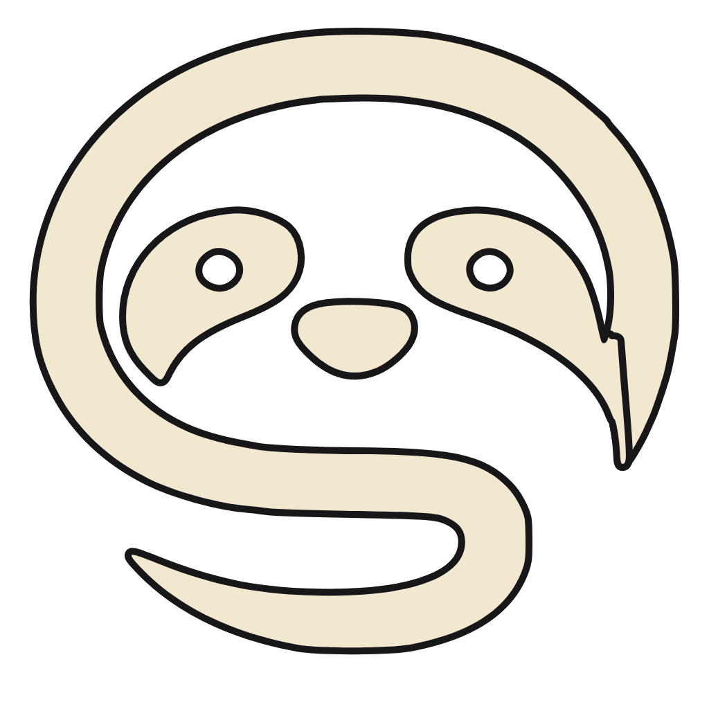

# ❄️ NevaStudio

<p align="center">
  
</p>

<p align="center">
  <b>Estudio autónomo de producción y edición de video vertical con IA y animación cinética fluida.</b>
</p>

<p align="center">
  
  
  
  <a href="LICENSE"></a>
</p>

---

**NevaStudio** es una suite de escritorio comercial para la creación, edición y automatización de videos verticales (9:16) diseñados para máxima retención en TikTok, Instagram Reels y YouTube Shorts. 

A diferencia de los editores basados en plantillas estáticas tipo PowerPoint, NevaStudio integra agentes de IA autónomos (con **Google Antigravity** como motor #1 y soporte para Claude y OpenAI), un pipeline de renderizado determinista en **Remotion**, motor de voz en streaming y navegación automatizada por CDP para distribución masiva.

---

## ✨ Características Principales

### 🎬 Los 5 Mandamientos de Animación Cinética Fluida
NevaStudio prohíbe las transiciones genéricas y estáticas, implementando por defecto:
1. **Revelado de Textos desde Máscara (`Text Mask Reveal`):** Titulares y palabras con desplazamiento vertical elástico (`translateY: 105% → 0%`) y rotación sutil (`rotate: 2deg → 0deg`) con física de muelles.
2. **Encadenamiento por Impacto (`Momentum Push`):** Elementos entrantes interactúan físicamente empujando a los existentes con rebote (`overshoot`).
3. **Cámara Dinámica Continua (`Camera Tracking`):** Viewport virtual dinámico con zoom-in guiado al foco de atención y paneo elástico.
4. **Transición Morfométrica Continua (`Morphing Seamless`):** Transformación elástica de tarjetas y contenedores de una escena a otra sin cortes a negro.
5. **Sincronización Rítmica con la Narración (`Rhythmic Audio Lock`):** Impactos visuales y SFX calibrados al milisegundo exacto de la locución.

---

### 🖥️ Interfaz Cupertino Dark Glass
* **Diseño Premium:** Paleta Zinc-950 (`#09090b`), efectos de cristal esmerilado translúcido con desenfoque (`backdrop-filter: blur(24px)`).
* **Dynamic Island Toggle:** Alternancia instantánea con un clic entre:
  * **Modo Creator:** Optimizado para viralidad, Shorts, TikTok, engagement y cliffhangers.
  * **Modo Marketer:** Enfoque comercial B2B, anuncios directos, testimonios y conversión.

---

### 🧠 Arquitectura de Motor Modular (8 Sprints)

| Módulo | Descripción Técnica |
| :--- | :--- |
| **Pi Agent & Antigravity** | Panel copilot multi-proveedor con **Antigravity** como proveedor nativo preferente, guiando la redacción de guiones y la orquestación. |
| **Perfilador de Hardware** | Detección automática de CPU, hilos y RAM (calibrado para equipos desde 12 GB RAM), mostrando tiempos estimados de renderizado y protecciones de memoria. |
| **Motor de Audio Ultrarrápido** | Síntesis TTS en streaming (<1.5s) con alineación temporal palabra por palabra (`timestamps.json`), fallback offline sintético y clonador de voz zero-shot. |
| **Ghost Browser Vault (CDP)** | Navegación autónoma en Chrome vía CDP (`--remote-debugging-port=0`), aislamiento de perfiles por red social y regla `browser.disconnect()` para preservar sesiones indefinidamente. |
| **Skills Hub & Prompt Vault** | Gestor interactivo de habilidades de video (Documental, Procedural, Kinetic Typography, Micro-dramas) y almacenamiento persistente de prompts. |
| **Fábrica de Lotes (Batch Factory)** | Generación masiva automatizada con cola de renderizado en segundo plano y métricas en tiempo real. |

---

## 🚀 Instalación y Puesta en Marcha

### Requisitos Previos
* **Node.js:** Versión 20+ o 24 (recomendado).
* **Python:** 3.10+ (con FFmpeg disponible en el PATH).

### Clonar y Ejecutar

```bash
# 1. Clonar el repositorio
git clone https://github.com/snowingt/nevastudio.git
cd nevastudio

# 2. Instalar dependencias
npm install

# 3. Iniciar el estudio de desarrollo
npm start
```

El servidor backend y la interfaz web levantarán automáticamente en `http://localhost:4848`.

---

## 🛠️ Scripts del Proyecto

* `npm start`: Inicia el servidor de desarrollo y la interfaz de usuario.
* `npm run typecheck`: Comprobación estricta de TypeScript en todo el proyecto.
* `npm test`: Ejecución de la suite completa de pruebas unitarias.
* `npm run compilar`: Compila y empaqueta la aplicación de escritorio vía Electron Builder.
* `npm run redes`: Lanza las rutinas de publicación e interacción por CDP.

---

## 📁 Estructura del Repositorio

```
electron/     Bootstrap de Electron y Ghost Browser Vault (CDP)
server/       Servidor Node, controlador de Pi Agent y fábrica de lotes
web/          Interfaz React 19 + Vite con componentes Cupertino Glass
skills/       Habilidades de video y renderizado (Remotion, Motion Graphics)
python/       Procesos de voz (TTS rápido, clonación de audio)
replica/      Configuración de marca y módulos de licenciamiento
scripts/      Scripts de compilación, verificación y empaquetado
shared/       Tipos e interfaces compartidas entre cliente y servidor
```

---

## 📄 Licencia

Este proyecto está bajo la Licencia **MIT**. Consulta el archivo [LICENSE](LICENSE) para más detalles.

---

<p align="center">Desarrollado por <b>NevaStudio / Snowing Torres</b></p>
