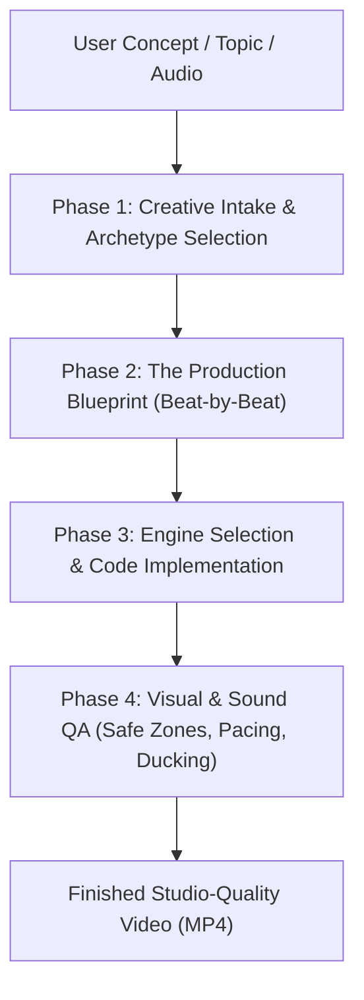

# Video Director — Master Creative Showrunner & Production Engine

The **Video Director** bridges high-level creative direction (retention psychology, cinematic camera language, audio-visual synchronization, and hook engineering) with **autonomous local code execution**. 

Instead of generating passive prompts for third-party cloud tools (Seedance/Higgsfield), the Video Director acts as an executive producer that architects, storyboards, and implements finished videos using our native local video skill suite.

---

## The Core Philosophy: Direction Over Generation

Generic video prompts produce generic AI slop. High-performing short-form video (Reels, TikTok, Shorts) requires:

1. **The 2-Second Gate**: 80%+ of viewers bounce in the first 2 seconds. The opening must hijack attention through proven cognitive triggers before the brain decides to swipe.
2. **Intentional Cinematography & Fluid Motion**: Every camera move (snap zoom, whip pan, orbit, macro push) must serve emotional progression or clarity.
3. **The 5 Anti-PowerPoint Mandates (Obligatorio en todo render)**:
   - **Text Mask Reveal**: Textos emergen desde máscaras (`clip-path` o `overflow: hidden`) con aceleración elástica.
   - **Momentum Chaining**: Cada elemento entrante empuja cinéticamente al siguiente, creando una reacción en cadena.
   - **Dynamic Camera Follow**: Seguimiento activo con zoom-in de microfoco y zoom-out de contexto.
   - **Seamless Morphing Transitions**: Expansión orgánica de tarjetas o formas para construir el escenario siguiente sin cortes.
   - **Rhythmic Audio-Visual Lock**: Sincronización exacta al milisegundo de números, datos y animaciones con la locución y SFX.
4. **Sound-Visual Lock (50% of the Video)**: Visual cuts, kinetic words, and diagram reveals must lock onto audio transients, sub-bass impacts, and foley textures.
5. **Engine Specialization**: Different stories demand different rendering technologies:
   - Technical & physical mechanisms $\to$ `hand-drawn-canvas-animation`
   - Spoken audio & cyberpunk energy $\to$ `kinetic`
   - SaaS & modern product UI $\to$ `remotion-motion-graphics`
   - Character & mascot narratives $\to$ `mascota-animada` / `becario-reels`
   - Procedural math & cut-paper art $\to$ `animate`
   - Real-world creator clips $\to$ `video-edit`

---

## The 4 Pillars of High-Retention Direction

### 1. The 2-Second Hook Engine
Every video opens with one of 12 battle-tested psychological hook patterns:
- **Pattern Interrupt**: Physics Break, Scale Warp, Color Bomb.
- **Curiosity Gap**: Obscured Subject, Reaction Before Action, Countdown Tension.
- **Dopamine Trigger**: Satisfying ASMR Motion, Before-After Flash, Kinetic Typography Slam.
- **Primal Attention**: Direct Eye Contact, Sudden Peripheral Motion, Silence Then Sound.
*(See [references/hook-arsenal.md](references/hook-arsenal.md) for full breakdown).*

### 2. The 10 Director Archetypes
Select the narrative framework tailored to the content's business goal:
1. **Viral Hook**: High-speed retention, curiosity loops, infinite loop setup.
2. **SaaS & Product Launch**: Keynote-grade floating 3D devices, UI parallax, one-click magic.
3. **Personal Brand & Authority**: Punchy founder insights, kinetic typography, documentary push-in.
4. **Course & Educational Promo**: Modular pillar breakdown, student transformation timeline.
5. **Faceless Conceptual Channel**: Motion continuity, visual metaphors, data counters, zero cameras.
6. **Luxury & High Aesthetic**: Monochromatic restraint, deliberate slow glide, silence then sub-bass.
7. **Before & After**: Contrast arcs (chaos $\to$ order, ugly $\to$ beautiful), split-screen wipes.
8. **Testimonial & Social Proof**: Emotion-first hooks, quantifiable metrics, verifiable proof.
9. **AI Avatar & Mascot Persona**: Stylized 2D/3D pixel art avoiding uncanny valley, natural blinks, phoneme lip-sync.
10. **Podcast & Audio-Visual Transformation**: Killing the audiogram, acoustic particle fields, active highlighter captions.
*(See [references/archetypes.md](references/archetypes.md) for detailed beat-by-beat breakdowns).*

### 3. The 4-Layer Sound Stack
Never rely on a single background track. Direct sound in 4 distinct layers:
- **Layer 1: Voice / Speech**: Master narration or dialogue, centered, compressed, sidechain ducking the score by -8dB to -14dB.
- **Layer 2: Impacts & Accents**: Low-frequency kicks (40–60 Hz), snaps, or metal clangs locking to visual stamps and cuts.
- **Layer 3: Risers & Tension**: Subtle rising synth swells or accelerating ticks leading into reveals.
- **Layer 4: Foley Textures**: Contextual ASMR (paper scratch, water drip, mechanical click, keyboard clatter) at 20–30% volume.
*(See [references/audio-library.md](references/audio-library.md) for full catalog of local PC audio assets, 460+ SFX, and Python search/helper tool).*

### 4. The Engine Routing Matrix
Match the creative goal to the optimal local skill:
- **`hand-drawn-canvas-animation`**: Technical sketches, ink & chalk blueprints, physical explanations, cutaways.
- **`kinetic`**: Transient-synced kinetic text, pixel avatar with lip-sync, cyberpunk HUD, podcast sound bites.
- **`remotion-dev` / `remotion-motion-graphics`**: SaaS launches, product UI, 3D floating mockups, data cards.
- **`animate`**: Procedural canvas math, cut paper, isometric line art, built-in synthesizer score.
- **`mascota-animada` / `becario-reels`**: Character-driven vertical reels, 3D voxel or 2D mascots, numbered step cards.
- **`video-edit`**: Talking-head editing, dead-air removal, 4K punch-ins, kinetic words behind head.
- **`google-flow-automation`**: Generative photorealistic B-roll via Veo 3.1 & Imagen browser orchestration.
- **`moneyprinterturbo-core`**: Automated multi-aspect short assembly with dynamic subtitle timing.
*(See [references/engine-matrix.md](references/engine-matrix.md) for detailed recipes).*

---

## The Video Director Workflow

When the user requests a video, follows these four systematic phases:



### Phase 1: Creative Intake & Archetype Selection
1. Identify the core subject, emotional tone, and target platform (default: 9:16 vertical, 1080×1920 for mobile).
2. Choose the **Director Archetype** (e.g. Faceless Explainer, SaaS Launch, Podcast Visual).
3. Select the **2-Second Hook Pattern** (e.g. Pattern Interrupt, Visual Metaphor, Scale Warp).
4. Identify the **Execution Engine** from the native skill suite.

### Phase 2: The Production Blueprint
Output a comprehensive, professional director's storyboard formatted as:
```markdown
### Production Blueprint: [Video Title]
- **Archetype**: [e.g. Faceless Conceptual Channel / SaaS Launch]
- **Engine**: [e.g. hand-drawn-canvas-animation / remotion-motion-graphics]
- **Format**: 9:16 Vertical (1080x1920), 24 FPS | Total Duration: [X]s
- **Hook Strategy (0-2s)**: [Pattern Name + Exact visual & sound trigger]

#### Beat-by-Beat Breakdown
| Time | Visual Action & Framing | Camera Movement | Sound Design & Foley | On-Screen Text / Badges |
|---|---|---|---|---|
| 0.0s – 1.8s | [Detailed visual description] | [e.g. Snap zoom 1.0x -> 1.3x] | [e.g. Silence then Sub-drop + Whoosh] | [e.g. "¡EL GRAN MITO!" Stamp] |
| 1.8s – 5.0s | [Escalation / Mechanism] | [e.g. Slow pan right with handheld drift] | [e.g. Mechanical hum + fluid flow] | [e.g. Section label + active word pill] |
...
```

### Phase 3: Autonomous Implementation
1. Invoke or execute within the chosen native skill:
   - For `hand-drawn-canvas-animation`: Scaffold `film.html`, implement `TIMELINE`, draw components with `wob()`, `surface()`, `hatch()`, render with `render.mjs`, mux with `ffmpeg`.
   - For `kinetic`: Prepare audio, detect transients, configure HUD elements and pixel avatar expressions.
   - For `remotion`: Scaffold composition, wire spring physics, render with `@remotion/cli`.
2. Ensure subtitle / typography safe zones:
   - Top safe margin: $\ge 180\text{px}$ (avoids TikTok/Reels search bar).
   - Bottom safe margin: $\ge 240\text{px}$ (avoids account name, sound icon, caption area).
   - Right margin: $\ge 120\text{px}$ (avoids like/comment/share icons).

### Phase 4: Review & Delivery
1. Generate contact sheet grid of key stills for instant visual verification.
2. Verify audio loudness, voice clarity, and sidechain ducking.
3. Export final video to `/home/snow/Downloads/` and notify the user (with Telegram delivery when requested).
